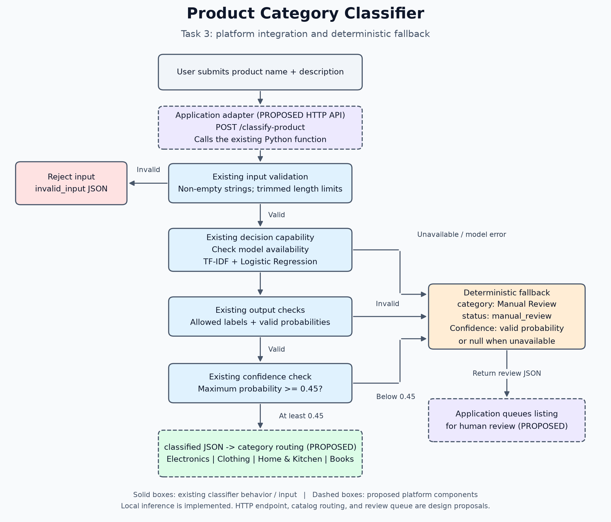

# A6 - Build and Integrate an AI Decision Capability

**Student Name:** [Enter student name]  
**Student ID:** [Enter student ID]  
**Project / Capability Name:** Product Category Classifier  
**Implementation Method:** Other - Python, scikit-learn TF-IDF and Logistic Regression  
**Course:** Platform Development  
**Week:** 08 - AI-Native Capability Design

## 1. Problem and Capability

**Problem:**  
A product catalog needs to assign new listings to Electronics, Clothing, Home &
Kitchen, or Books. Product names and descriptions vary, which makes manual sorting
time-consuming and simple wording rules difficult to maintain. This capability
predicts a category from the listing text and returns a structured decision.
Uncertain predictions and model failures are referred for manual review.

**Why AI?**  
A learned classifier can combine weighted words and phrases across labeled examples.
This helps handle variations in product descriptions without writing a separate
category rule for every expression. The implementation uses a real supervised
machine-learning pipeline rather than keyword-only routing. Deterministic checks
are used for validation and fallback, where predictable behavior is appropriate.

**Input:**  
The function accepts `product_name` and `description`, both non-empty strings.

```json
{
  "product_name": "Portable Bluetooth headphones",
  "description": "Wireless audio headphones with microphone and rechargeable battery"
}
```

**Expected Output:**  
A JSON-compatible dictionary with `category`, `confidence`, `status`, and `reason`.
The four automatic categories are **Electronics**, **Clothing**, **Home & Kitchen**,
and **Books**. **Manual Review** is a fallback outcome, not a fifth training class.
Invalid input is rejected with null category and confidence.

## 2. Decision Implementation

**Decision Configuration / Code:**  
The complete implementation and all training examples are supplied in
[`classifier.py`](classifier.py), with the dependency version in
[`requirements.txt`](requirements.txt). This project uses a local equivalent
decision model; it does not use Jev Playground or Jev API.

The training data consists of **48 synthetic labeled examples**, each containing
a product name and description:

| Category | Labeled examples |
|---|---:|
| Electronics | 12 |
| Clothing | 12 |
| Home & Kitchen | 12 |
| Books | 12 |
| **Total** | **48** |

The implementation trims and combines each name and description into one text input.
The existing pipeline configuration is:

```python
model = Pipeline([
    ("tfidf", TfidfVectorizer(ngram_range=(1, 2))),
    ("classifier", LogisticRegression(C=4.0, random_state=42, max_iter=1000)),
])
model.fit(texts, labels)
```

TF-IDF converts text into weighted unigram and bigram features. Logistic Regression
learns category weights and provides estimated class probabilities. These are the
library components documented in the official
[TF-IDF reference](https://scikit-learn.org/stable/modules/generated/sklearn.feature_extraction.text.TfidfVectorizer.html)
and [Logistic Regression reference](https://scikit-learn.org/stable/modules/generated/sklearn.linear_model.LogisticRegression.html).

Each `ProductClassifier()` instance trains once at construction. The public
`classify_product(product_name, description)` function lazily caches and reuses a
default instance. The model is kept in memory; a new process trains again. The
recorded execution environment was Python 3.13.14 and scikit-learn 1.9.1.

**Output Schema:**

| Required field | Type and allowed values |
|---|---|
| `category` | String: one of the four trained categories when classified, or `Manual Review` on fallback; null for invalid input |
| `confidence` | Finite number in `[0, 1]` when valid model probabilities are available; otherwise null |
| `status` | String: `classified`, `manual_review`, or `invalid_input` |
| `reason` | Non-empty string explaining the decision or fallback condition |

The highest estimated probability must be **at least 0.45** for classification.
Confidence is a model estimate, not a guarantee of correctness. This threshold is
an illustrative project setting and has not been calibrated on production data.
The reason explains the decision policy; it is not a generated explanation of
individual feature contributions.

### Test Results

The following table transcribes the six examples in
[`prediction_results.txt`](prediction_results.txt), generated by
[`demo_predictions.py`](demo_predictions.py). All six use the existing model's real
inference, including the low-confidence example. These complete input pairs differ
from the training examples. Displayed confidence values are rounded to six decimal
places, as in that log.

| # | Input | Expected Decision | Actual Decision | Pass/Fail |
|---|---|---|---|---|
| 1 | **Name:** Portable Bluetooth headphones<br>**Description:** Wireless audio headphones with microphone and rechargeable battery | Electronics; classified | Electronics; confidence 0.718315; classified | PASS |
| 2 | **Name:** Casual cotton shirt<br>**Description:** Soft cotton shirt with long sleeves and collar for everyday wear | Clothing; classified | Clothing; confidence 0.797699; classified | PASS |
| 3 | **Name:** Large cooking saucepan<br>**Description:** Kitchen cooking pot with lid for preparing food | Home & Kitchen; classified | Home & Kitchen; confidence 0.701209; classified | PASS |
| 4 | **Name:** Space adventure novel<br>**Description:** Paperback fiction book with imaginative stories and adventure chapters | Books; classified | Books; confidence 0.748030; classified | PASS |
| 5 | **Name:** Compact wireless speaker<br>**Description:** Portable Bluetooth audio speaker with rechargeable battery for wireless music | Electronics; classified | Electronics; confidence 0.757894; classified | PASS |
| 6 | **Name:** Smart recipe tablet<br>**Description:** Touchscreen tablet with digital cooking recipes and illustrated cookbook chapters | Manual Review; manual_review | Manual Review; confidence 0.376202; manual_review | PASS |

For this demonstration, PASS requires the actual category and status to match the
declared expectation. In the separate automated suite, the ambiguous-product test
permits either a valid classification or safe review; the observed result was review.

The automated suite in [`test_classifier.py`](test_classifier.py) also covers input
rejection and deliberately injected faults. Selected results from
[`test_results.txt`](test_results.txt) are:

| Scenario | Expected Decision | Actual Decision | Pass/Fail |
|---|---|---|---|
| Whitespace name; description `A useful product` | Reject invalid name | invalid_input; null category/confidence | PASS |
| Name `A product`; empty description | Reject invalid description | invalid_input; null category/confidence | PASS |
| Numeric name `123`; description `A useful product` | Reject non-string name | invalid_input; null category/confidence | PASS |
| Name `A product`; null description | Reject non-string description | invalid_input; null category/confidence | PASS |
| Simulated unavailable model | Manual Review | manual_review; null confidence; `Model unavailable.` | PASS |
| Simulated prediction exception | Manual Review | manual_review; null confidence; `Model prediction failed.` | PASS |
| Simulated invalid category | Manual Review | manual_review; null confidence; `Invalid model prediction.` | PASS |
| Simulated equal probabilities of 0.25 | Manual Review | manual_review; confidence 0.25 | PASS |
| Simulated malformed probabilities | Manual Review | manual_review; null confidence | PASS |
| Name of 201 characters or description of 5,001 characters | Reject excessive length | invalid_input; null category/confidence | PASS |
| Name `Zqxv`; description `Plmokn ytrewq` | Manual Review | manual_review; confidence 0.2611879742278097 | PASS |
| Simulated training failure | Manual Review | manual_review; null confidence; `Model unavailable.` | PASS |

**Evidence:**  
The saved automated run ends with:

```text
Ran 18 tests in 0.020s

OK
```

The separate prediction demonstration reports:

```text
Summary: 6/6 PASS; 0 FAIL
```

The Task 3 demonstration reports `Summary: 4/4 PASS`, detailed below. These runs
overlap in their inputs and checks; their counts are not combined into a unique-test
count or an accuracy percentage. Passing checks show the observed behavior on this
small set, not general production accuracy. Original evidence logs are supplied
unchanged; they were not regenerated to prepare this report.

## 3. Platform Integration

**Architecture Diagram:**



The diagram is supplied as [`task3_architecture.png`](task3_architecture.png).
The existing Mermaid source is also supplied in [`architecture.mmd`](architecture.mmd).

The intended flow is user submission -> application -> validated classifier decision
-> category routing or human review. Solid boxes show the existing classifier behavior
and input; dashed boxes identify proposed platform components.

**Implementation boundary:** The Python classifier, validation, and fallback were
executed locally. **The HTTP API is proposed and was not executed.** No web server,
HTTP request, catalog update, or human review queue was implemented or demonstrated.
The consuming application would use `classified` results for routing, queue
`manual_review` results, and request corrections for `invalid_input` results.

**Example API Request - PROPOSED DESIGN:**

```http
POST /classify-product
Content-Type: application/json
```

```json
{
  "product_name": "Portable Bluetooth headphones",
  "description": "Wireless audio headphones with microphone and rechargeable battery"
}
```

The proposed adapter would extract the two fields and call the existing
`classify_product` function, reusing a model instance within the application process.

**Example API Response - PROPOSED HTTP DESIGN:**  
The proposed HTTP status is **200 OK**. The response body below is an **actual local
Python function result**, copied from [`task3_failure_evidence.txt`](task3_failure_evidence.txt).
It is not an observed HTTP response.

```json
{
  "category": "Electronics",
  "confidence": 0.7183149479308034,
  "status": "classified",
  "reason": "Highest estimated category probability meets the 0.45 threshold."
}
```

The proposed adapter would use HTTP 200 for classified or review outcomes and HTTP
400 for invalid input. These status mappings are design proposals, not executed behavior.

**Validation Rules:**

| Layer | Rules |
|---|---|
| Existing function input | Both arguments must be strings containing non-whitespace text. Trim whitespace before checking lengths and preparing model input. Limit name to 200 characters and description to 5,000 characters after trimming. Reject invalid input before inference. |
| Existing prediction validation | Require exactly the four permitted labels, one probability row of length four, finite probabilities in `[0, 1]`, and a sum close to one using `math.isclose(sum, 1.0, abs_tol=1e-6)` with its default relative tolerance. |
| Existing decision output | Construct exactly the four documented fields. A classified result has a permitted category and probability at least 0.45. Review has category Manual Review. Invalid input has null category/confidence. |
| Proposed HTTP adapter | Reject malformed JSON, non-object request bodies, and missing fields before calling the function. Check the result contract and serialize valid JSON. These HTTP-layer checks are not implemented. |

**Fallback Strategy:**

| Trigger | Deterministic existing response |
|---|---|
| Valid probabilities but maximum below 0.45 | Manual Review; status manual_review; retain maximum probability; reason explains low confidence |
| Prediction raises an exception | Manual Review; status manual_review; null confidence; reason `Model prediction failed.` |
| Model unavailable, including caught training failure | Manual Review; status manual_review; null confidence; reason `Model unavailable.` |
| Invalid prediction labels, shape, or probabilities | Manual Review; status manual_review; null confidence; reason `Invalid model prediction.` |
| Invalid user input | Reject with invalid_input; null category/confidence; reason identifies the validation problem |

The fallback does not guess a category or substitute keyword-based routing. Internal
exception details are not returned to callers. The current model runs locally and
does not call a remote service, so no remote timeout was tested. A future external
service adapter would need timeout/unavailability handling mapped to Manual Review.

**Fallback Evidence:**  
The real ambiguous recipe tablet produced:

```json
{
  "category": "Manual Review",
  "confidence": 0.37620155496730606,
  "status": "manual_review",
  "reason": "Confidence below 0.45; human review required."
}
```

For simulated model failure, [`task3_demo.py`](task3_demo.py) temporarily patched the
fitted model's `predict_proba` method to raise a `RuntimeError`. It called the unchanged
classifier on the headphones input, verified that the injected method was called
once, and checked the actual response. This is deliberate failure injection, not a
naturally occurring outage. The real classifier exception handler produced:

```json
{
  "category": "Manual Review",
  "confidence": null,
  "status": "manual_review",
  "reason": "Model prediction failed."
}
```

The method was restored after the temporary patch, and another prediction returned
the original Electronics result. The saved Task 3 execution records:

| Check | Observed result | Outcome |
|---|---|---|
| Normal local prediction | Electronics, 0.7183149479308034 | PASS |
| Real low-confidence input | Manual Review, 0.37620155496730606 | PASS |
| Simulated prediction exception | Manual Review, null confidence; injected method called | PASS |
| Prediction after removing patch | Original Electronics result restored | PASS |

```text
Summary: 4/4 PASS
```

Full evidence is in [`task3_failure_evidence.txt`](task3_failure_evidence.txt), with
further integration details in [`task3_integration.md`](task3_integration.md).

## 4. Engineering Reflection

**What worked:**  
The five straightforward products in the prediction demonstration reached their
expected categories across all four classes. The ambiguous tablet reached Manual
Review at confidence 0.376202. The automated suite rejected invalid inputs and
handled injected model failures, invalid predictions, and low confidence. The
temporary failure demonstration also confirmed that ordinary prediction resumed
after the mock was removed.

**Unexpected behavior or mistakes:**  
The recipe tablet combined electronics and book-related wording and did not reach
the automatic-classification threshold. This illustrates an ambiguous decision
rather than an observed wrong category. No category mismatch appeared among the
five straightforward demonstration products. The small, vocabulary-similar sample
does not establish broad accuracy, and simulated faults are not naturally observed
model mistakes.

**Production risks:**  
Only 48 synthetic English examples cover a narrow vocabulary. Mixed-category,
multilingual, unfamiliar, or misleading descriptions could produce incorrect,
potentially confident decisions. Probabilities are uncalibrated, and the threshold
has not been selected through a representative validation study. Broad exception
handling protects callers but would need private diagnostic logging. A real
integration also needs a staffed review queue, privacy controls, and monitoring;
these components are currently proposals.

**Next improvement:**  
Collect representative labeled catalog data and reserve independent training,
validation, and test sets. Measure per-category precision/recall and the review
rate, calibrate probabilities, and tune the threshold using validation results.
Then add human feedback, model versioning, diagnostic logging, and drift monitoring.
Implement and test the proposed HTTP adapter separately before claiming API integration.

## 5. References

1. Course materials: `assignment_8.md`, **Assignment A6: Build and Integrate an AI
   Decision Capability**, Platform Development, Week 08. Supplied by the teacher.
2. Course materials: `assignment8_template.md`, **A6 - Individual Submission Template**.
   Used for this report's six-section structure.
3. scikit-learn documentation: [TfidfVectorizer](https://scikit-learn.org/stable/modules/generated/sklearn.feature_extraction.text.TfidfVectorizer.html)
   and [LogisticRegression](https://scikit-learn.org/stable/modules/generated/sklearn.linear_model.LogisticRegression.html).
   Supporting references for the implemented text features and learned classifier.
4. Python documentation: [unittest.mock](https://docs.python.org/3/library/unittest.mock.html).
   Supporting reference for temporary method replacement and injected exceptions.
5. Project implementation: [`classifier.py`](classifier.py),
   [`test_classifier.py`](test_classifier.py), and [`requirements.txt`](requirements.txt).
6. Actual execution records: [`test_results.txt`](test_results.txt),
   [`prediction_results.txt`](prediction_results.txt), and
   [`task3_failure_evidence.txt`](task3_failure_evidence.txt).
7. Project integration and reproduction materials: [`README.md`](README.md),
   [`demo_predictions.py`](demo_predictions.py), [`task3_demo.py`](task3_demo.py),
   [`task3_integration.md`](task3_integration.md), and
   [`task3_architecture.png`](task3_architecture.png).

**AI Assistance Disclosure:**  
OpenAI's Codex coding assistant helped develop the Python implementation, synthetic
labeled examples, automated tests, demonstration scripts, diagram, documentation,
and this report. It also ran the earlier local Python demonstrations and inspected
their saved output. The category predictions and PASS/FAIL evidence quoted here
came from actual Python execution, not invented model outputs. This report was
assembled from the existing source files and saved evidence without changing the
code or rerunning the evidence files. AI assistance did not constitute an HTTP
integration test: the API remains proposed and was not executed.

## 6. Submission Checklist

- [x] Decision configuration or source code included as supporting files
- [x] At least five different product test inputs and actual decisions included
- [x] Actual execution evidence supplied in the three linked result logs
- [x] Integration architecture included as an embedded PNG
- [x] Example API request and response included and clearly labeled proposed
- [x] Input/output validation and deterministic fallback explained
- [x] Simulated model failure and recovery evidence included
- [x] Engineering reflection based on observed tests completed
- [x] References and AI assistance disclosure included
- [x] No API keys, access tokens, or private user data included in this report
- [ ] Complete student name and student ID above
- [ ] Export the report to `A6_StudentID.pdf`, checking that the diagram and tables render
- [ ] Submit the PDF with the linked supporting source files and evidence
